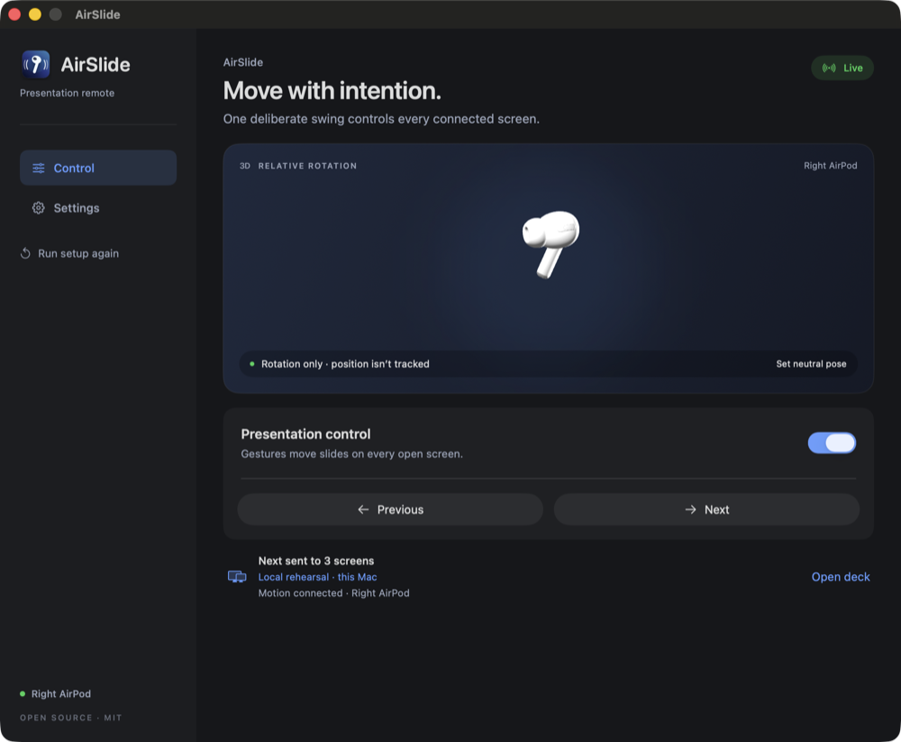
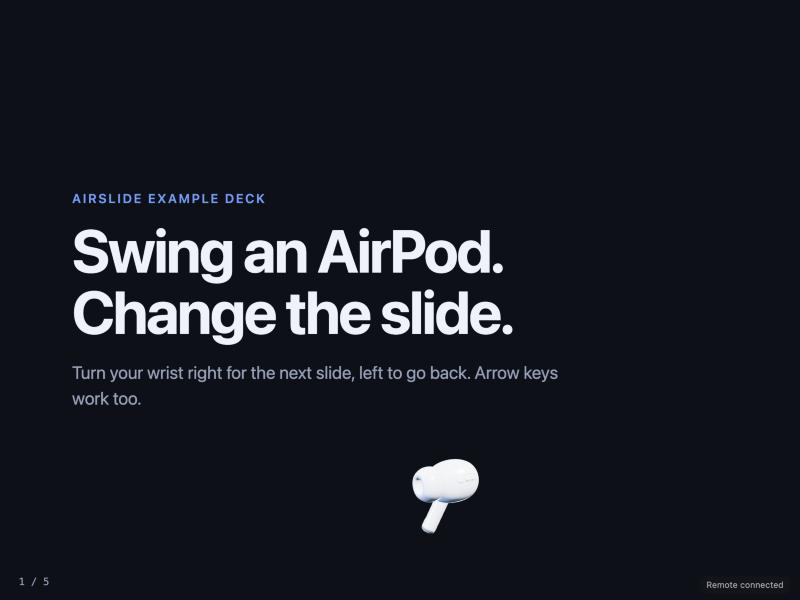
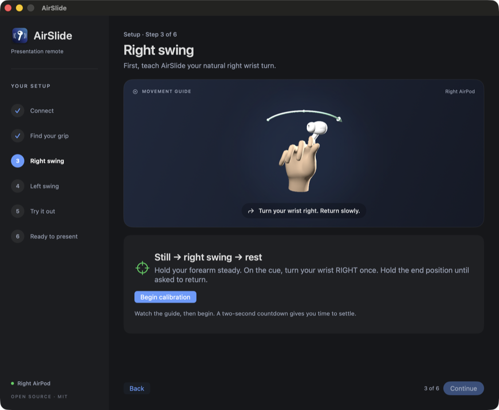

# AirSlide

**Change slides by swinging an AirPod.**

AirSlide turns one AirPod into a presentation remote. Hold it between two fingers, turn your wrist right for the next slide and left to go back. A native macOS app reads the AirPod's motion sensor and recognises deliberate swings. A small relay then moves every open copy of your deck at once: your laptop, the projector and anyone following along remotely.



- **Native and private.** Motion is processed on the Mac. Only the gesture leaves it: `next` or `prev`, and which AirPod.
- **Calibrated to you.** A six-step setup learns your own right and left wrist turn, then lets you practise without moving any slides.
- **Every screen follows.** One gesture reaches every browser that has the deck open, with a short 3D AirPod animation.
- **Any HTML deck.** Anything that moves on the arrow keys works without changes, including reveal.js and most hand-built decks.

## How it works

```
AirPod ──Core Motion──▶ AirSlide.app ──HTTPS + key──▶ relay ──WebSocket──▶ every open deck
```

1. The Mac app reads the AirPod's rotation rate through `CMHeadphoneMotionManager`. Calibration records the axis, direction and strength of your right and left swing, and stores a separate threshold for each.
2. A swing detector arms only after a moment of stillness and waits out a cooldown after each gesture, so returning your wrist to neutral never goes back a slide.
3. On a swing, the app posts a command such as `{"direction": "next", "id": "<uuid>", "side": "right"}` to the relay's `/api/command`, with your key as a bearer token.
4. The relay serves your deck, adds a small client script to every page, and broadcasts the command over a WebSocket. The client presses the arrow key the deck already understands and plays the AirPod animation.



## Requirements

- An Apple Silicon Mac with macOS 14 Sonoma or later and the Xcode command line tools (`xcode-select --install`).
- AirPods with head tracking: AirPods Pro, AirPods (3rd generation or later) or AirPods Max.
- Node.js 22 or later for the relay.

## Try it on one Mac

Create one key for the app and the relay, then run the relay with the bundled example deck:

```bash
git clone https://github.com/Tarabcak/airslide.git
cd airslide
npm install

mkdir -p ~/.config/airslide && chmod 700 ~/.config/airslide
printf 'REMOTE_TOKEN=%s\n' "$(openssl rand -hex 32)" > ~/.config/airslide/local-relay.env
chmod 600 ~/.config/airslide/local-relay.env

REMOTE_TOKEN="$(sed -n 's/^REMOTE_TOKEN=//p' ~/.config/airslide/local-relay.env)" npm start
```

The relay now serves the example deck at <http://127.0.0.1:8094>. In a second terminal, in the same folder, build and open the app:

```bash
bash scripts/build-mac.sh
open build/AirSlide.app
```

Follow the setup. It asks for Motion & Fitness access when your AirPods connect, then walks you through the grip and both calibration swings. Turn off **Automatic Ear Detection** for your AirPods (System Settings, then your AirPods) so an AirPod keeps reporting motion outside your ear.

When setup is done, open **Settings → Device & view** and switch on **Local rehearsal on this Mac**. Back on the **Control** screen, choose **Open deck**, turn on **Presentation control** and swing right.



## Present for real

Run the relay where every viewer can reach it over HTTPS. The app only sends the key over HTTPS, or over plain HTTP to this Mac.

With Docker, serving your own deck (create the key with `openssl rand -hex 32`):

```bash
export REMOTE_TOKEN="<your key>"
docker build -t airslide-relay .
docker run -d --name airslide --restart unless-stopped \
  -p 127.0.0.1:8080:8080 \
  -e REMOTE_TOKEN="$REMOTE_TOKEN" \
  -e DECK_DIR=/deck -v "$PWD/my-deck:/deck:ro" \
  airslide-relay
```

Then put a TLS proxy in front of it. With [Caddy](https://caddyserver.com), which also forwards WebSockets:

```
slides.example.com {
	reverse_proxy 127.0.0.1:8080
}
```

On the presenting Mac, copy [`relay.env.example`](relay.env.example) to `~/.config/airslide/relay.env`, fill in your relay's URL and key, `chmod 600` it, and turn local rehearsal off. Everyone opens `https://slides.example.com/`.

Commands are relative, so every screen should start on the same slide. A screen that joins late moves from wherever it is.

## Use your own deck

Point the relay at the folder that holds your deck's `index.html`:

```bash
REMOTE_TOKEN="$(sed -n 's/^REMOTE_TOKEN=//p' ~/.config/airslide/local-relay.env)" \
  DECK_DIR=/path/to/my-deck npm start
```

The relay injects its client into every HTML page in that folder. Decks that move on <kbd>→</kbd> and <kbd>←</kbd> work as they are. If yours navigates some other way, define a hook and AirSlide calls it instead of pressing a key:

```js
window.airslideNavigate = direction => direction === 'next' ? deck.next() : deck.prev();
```

The relay serves common web files (HTML, CSS, JavaScript, JSON, images, fonts, audio, video and PDF). Hidden files, other file types and anything outside the folder return 404. To tune the AirPod animation against your deck without sending commands, open `/_airslide/preview.html` on the relay.

## Configuration

| Setting | Where | Default | Meaning |
|---|---|---|---|
| `REMOTE_TOKEN` | Relay environment | required | Shared key, at least 32 characters. Must match the Mac. |
| `DECK_DIR` | Relay environment | `example-deck` | Folder to serve. |
| `HOST`, `PORT` | Relay environment | `127.0.0.1`, `8094` | Listen address. The Docker image uses `0.0.0.0` and `8080`. |
| `REMOTE_URL`, `REMOTE_TOKEN` | `~/.config/airslide/relay.env` | none | Live relay used when local rehearsal is off. |
| `REMOTE_URL`, `REMOTE_TOKEN` | `~/.config/airslide/local-relay.env` | `http://127.0.0.1:8094` | Relay used for local rehearsal. |

Gesture sensitivity, the time between gestures, reversed directions and the hand guide are set in the app and saved automatically.

## Security and privacy

- The key is the only thing that can move your slides. Keep it in the config file and the relay's environment. If it leaks, restart the relay with a new key and update the Mac.
- Watching needs no key. Anyone with the deck's URL can view it, so keep confidential decks off public hosts.
- The relay accepts at most four commands a second, ignores repeated command IDs for a minute and limits requests and WebSocket messages to 1 KB and connected viewers to 500.
- Motion samples never leave the Mac. The relay only sees the direction and which AirPod was used.

## Troubleshooting

- **No motion.** Check System Settings → Privacy & Security → Motion & Fitness, wear both AirPods for a moment, then choose **Retry motion**. AirSlide retries on its own three times first.
- **Motion stops when you take the AirPod out.** Turn off Automatic Ear Detection for your AirPods.
- **"Sensor switched. Recalibrate for this AirPod."** macOS reports motion from one AirPod at a time. If it switches sides, run calibration again with the AirPod you are holding.
- **Swings are missed or fire twice.** Turn your wrist rather than moving your arm, since AirSlide measures rotation. Adjust sensitivity and the time between gestures in Settings, or recalibrate.
- **"Relay not configured."** The app could not find a valid `REMOTE_URL` and a key of 32 or more characters in the config file shown in Settings.
- **Opening a copied build on another Mac.** Builds are ad-hoc signed, not notarised, so macOS blocks a copy from elsewhere. Build on that Mac, or try to open the app once and then allow it in System Settings → Privacy & Security → Open Anyway.

## Development

```bash
npm test                    # relay: auth, validation, broadcast, file boundary
bash scripts/test-mac.sh    # app: swing detector, calibration, setup flow, relay config
bash scripts/build-mac.sh   # builds build/AirSlide.app
```

| Path | Contents |
|---|---|
| `macos/` | SwiftUI app: motion and gesture logic (`AirSlide.swift`), interface (`AirSlideView.swift`), SceneKit view (`MotionScene.swift`), tests and assets |
| `relay/server.cjs` | Relay: deck server, command API and WebSocket broadcast |
| `relay/public/` | Browser client, AirPod animation, preview page and vendored three.js |
| `example-deck/` | A five-slide deck to try things with |
| `scripts/` | Build and test scripts, plus the generators for the icon and 3D assets |

## Licence

MIT, see [`LICENSE`](LICENSE). The bundled three.js, AirPods Pro model and hand mesh keep their own licences, listed in [`THIRD_PARTY_NOTICES.md`](THIRD_PARTY_NOTICES.md).

AirPods is a trademark of Apple Inc. AirSlide is an independent project, not affiliated with or endorsed by Apple.
